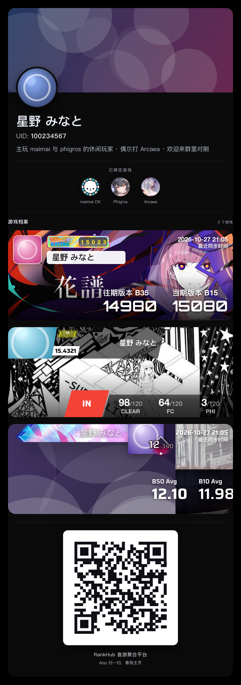

# rankhub-qqbot-example

一个**可运行的 RankHub Open API 接入示例**：QQ 官方机器人（API v2 WebSocket + 被动回复）
通过 RankHub OAuth 绑定用户账号，读取本人 maimai / phigros 成绩并渲染成图片。

- RankHub Open API 的完整用法（两种授权流程、令牌轮换、`/v1/games/**`、错误与限流）
  见 **[docs/OPENAPI.md](docs/OPENAPI.md)**；
- 部署（Docker Compose、素材挂载、密钥注入）见 **[docs/DEPLOY.md](docs/DEPLOY.md)**。





## 能做什么

| 指令 | 说明 |
| --- | --- |
| `/help` | 指令与绑定说明 |
| `/bind [UID]` | 绑定 RankHub：私聊直接 `/bind`，群聊 `/bind <UID>`；扫机器人发的二维码在 App 内确认 |
| `/unbind` | 撤销令牌并删除本地绑定 |
| `/me` | **玩家名片**：账号头像/背景 + 已绑定游戏图标条 + maimai/phigros/arcaea 卡片 + 公开账号二维码 |
| `/me diff` | 查看 Phigros 卡片当前展示难度（EZ/HD/IN/AT，默认 IN） |
| `/me diff <EZ\|HD\|IN\|AT>` | 切换 Phigros 卡片难度（写回 RankHub 用户偏好，App 与机器人共享） |
| `/b50` | maimai B50 图片（照搬 [maimaiDX](https://github.com/Yuri-YuzuChaN/maimaiDX) 的绘制） |
| `/arc` | Arcaea B50 海报（移植 [best-posters](https://github.com/Project-Fukakai) 的 arcaea 版式） |
| `/rks` | phigros RKS / b19 图片（照搬 [phi-plugin](https://github.com/Catrong/phi-plugin) 的 b19 模板） |
| `/best <game>` | 任意游戏最佳成绩（文字） |
| `/score [game] <关键词>` | 在本人成绩里按曲名模糊查询（文字） |
| `/games` | 服务端能力矩阵 |
| `/status` | 绑定与运行状态 |

- 只申请 `openid profile offline_access game:read`；第三方应用只能读**授权用户本人**的数据。
- 所有回复都是**被动回复**（`msg_id` + 自增 `msg_seq`），并带 `message_reference` 引用原指令；
- 耗时操作（`/b50`、`/rks`、`/me`、`/best`、`/score`）先回一条「正在生成…」提示，再发结果。

## 结构

```
src/
  contracts/  冻结接口（QQ / RankHub / Store / Renderer）
  config/     env 校验（zod）
  qq/         AccessToken、REST（文本/图片/分片上传）、WebSocket 网关、被动回复
  rankhub/    授权码/设备码流程、刷新单飞、games client、错误映射
  store/      node:sqlite + AES-256-GCM（refresh/access token 加密落库）
  render/phi/ phi-plugin b19 模板 + Playwright 截图
  render/mai/ maimaiDX B50 绘制（PIL → @napi-rs/canvas 移植）
  render/card/ 玩家名片（HTML + Playwright）
  render/arc/ Arcaea B50 海报（best-posters 版式）
  commands/   指令实现
  bot/        装配与事件管线
scripts/      素材拉取/校验、live 冒烟
vendor/       素材缓存（gitignore）
```

## 起步

```bash
pnpm install
cp .env.example .env.local     # 填 QQ_APP_SECRET / RANKHUB_CLIENT_SECRET，并生成 TOKEN_ENC_KEY
openssl rand -base64 32        # TOKEN_ENC_KEY
pnpm assets:fetch              # phi-plugin b19 素材 + maimaiDX 资源包 + 曲绘
pnpm typecheck && pnpm test
pnpm start
```

- `pnpm assets:fetch` 会下载 maimaiDX `Resource CN1.55.7z`（约 467MB）；
  已有解压好的资源包时用 `MAIMAIDX_STATIC=/path/to/static` 复用。
- 没有真实 QQ / RankHub 凭据时，`pnpm test`（单测）与 `pnpm test:e2e`（假 QQ + 假 RankHub）可完整跑通。
- 绑定默认走「授权码 + App 扫码」（`POST /v1/interaction/oauth-authorizations`）；
  设备码流程与两个服务端缺陷的记录见 `docs/DECISIONS.md`。

## 验证

```bash
pnpm typecheck     # tsc --noEmit
pnpm test          # 单测（QQ 传输、授权流程、存储、渲染数据映射）
pnpm test:e2e      # 假 QQ 网关 + 假 RankHub 的端到端
pnpm test:render   # 渲染像素/结构验收（需先 pnpm assets:fetch）
pnpm live:verify   # 用真实绑定渲染 b50 / rks（需先绑定）
```

## 部署

见 [docs/DEPLOY.md](docs/DEPLOY.md)：Dockerfile 内置 Chromium，`vendor/` 与 `data/` 走 volume，
`.env` 通过 `env_file` 注入；容器 `restart: unless-stopped`。

## 许可与署名

本项目以 **GPL-3.0-or-later** 发布：phigros 渲染复用了
[phi-plugin](https://github.com/Catrong/phi-plugin)（GPL-3.0）的 b19 模板与素材；
maimai 渲染移植/复用了 [maimaiDX](https://github.com/Yuri-YuzuChaN/maimaiDX)（MIT）的绘制方案与素材。
详见 `NOTICE`。
